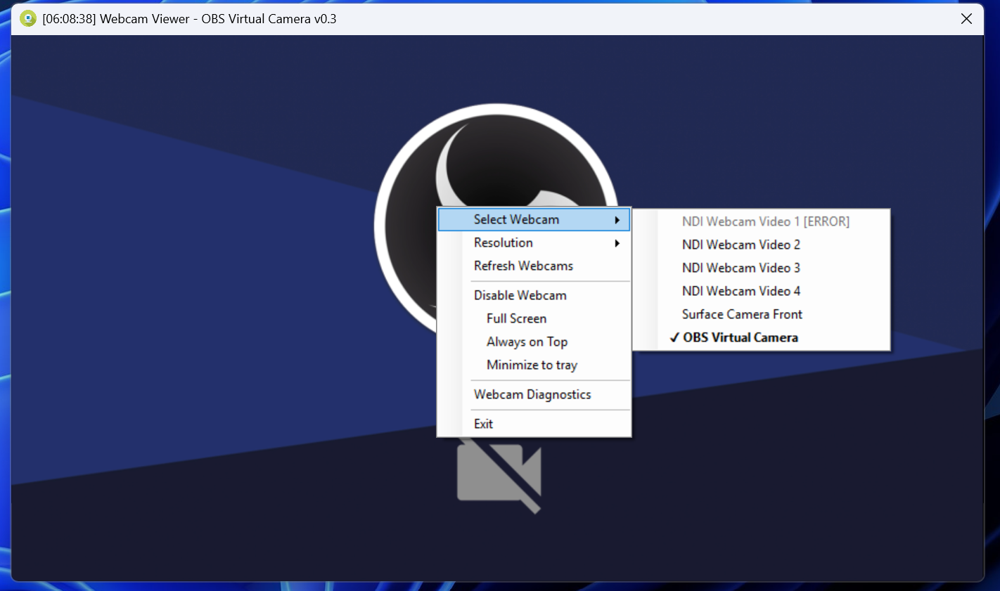

# Webcam Viewer (WebcamWindows)

A tiny Windows tray application that shows any webcam in a clean, borderless window.  
Originally built to use the **Blackmagic ATEM Mini Pro** USB-C output (set to Multiview) as a simple, always-visible webcam window, without all the extra UI and clutter of typical webcam/streaming software.

The app is written in C# using Windows Forms, OpenCvSharp and DirectShow.

## Why?

When using an **ATEM Mini Pro** as a USB-C webcam device in **Multiview** mode, Windows just sees it as “a webcam”. Most webcam programs:

- Add a lot of UI and controls around the video  
- Don’t handle aspect ratio nicely in a resizable window  
- Don’t offer an easy tray-based workflow with quick device / resolution switching  

So this project is a minimal viewer that:

- Picks the ATEM (or any webcam) as a standard camera device  
- Shows the feed in a clean, resizable window  
- Can run hidden in the tray and come back with one click  

## Features

- **Simple video window**
  - Single video panel that fills the window
  - Configurable background, with no controls over the image

- **Multi-camera support**
  - Enumerates all DirectShow video devices (e.g. ATEM, USB webcams, capture cards)
  - Switch cameras from the tray context menu (`Select Webcam`)
  - Failed devices are marked as `[ERROR]` and can be refreshed

- **Resolution management**
  - Uses DirectShow to discover all supported video formats/resolutions
  - Automatically selects the **smallest** available resolution on startup (to keep CPU/bandwidth low)
  - Manual selection of resolution from the `Resolution` submenu
  - Separate “Refresh Resolutions” action if devices change at runtime

- **Resizable window and Windows Snap**
  - Resize the bordered window or use Windows Snap to place it alongside other windows.
  - The camera image fits the available space without cropping or distorting its aspect ratio. The window stays at the size and position you choose.
  - Choose black, white, or a custom color for the empty space around the image using `Background Color` in the context menu. The choice is saved.

- **Tray icon & context menu**
  - Always-visible tray icon with context menu:
    - `Select Webcam`
    - `Resolution`
    - `Refresh Webcams`
    - `Enable / Disable Webcam`
    - `Background Color`
    - `Full Screen`
    - `Always on Top`
    - `Minimize to Tray`
    - `Webcam Diagnostics`
    - `Exit`

- **Window modes**
  - **Borderless mode**: double-click the video area to toggle bordered ↔ borderless
  - Use bordered mode for window-edge resizing and Windows Snap layouts.
  - **Full screen mode**: use `Full Screen` in tray menu (on current monitor)
  - **Always on top**: optional, via tray menu

- **Minimize / close behavior**
  - On minimize, window hides and webcam can be disabled to free the device
  - Optional **“Minimize to Tray”**:
    - Clicking the window “X” hides to tray instead of exiting
    - Double-click tray icon to restore and re-enable webcam

- **Settings persistence**
  - Automatically saves configuration options to `WebcamWindows.json` on settings change or exit.
  - Automatically restores last active webcam, selected resolution, background color, window modes (borderless/fullscreen), "always on top", and "minimize to tray" states on startup.

- **Diagnostics & troubleshooting**
  - Context menu item `Webcam Diagnostics` opens a dedicated diagnostics window showing OpenCV, DirectShow, and OS details, alongside active webcam status and troubleshooting advice.
  - Enables viewing a complete table of supported pixel formats and frame rates for the selected device.

- **Small touches**
  - Current time `[HH:mm:ss]` is shown in the window title bar alongside active webcam name and version.
  - Title updates to indicate when the camera is "[DISABLED]".

## Tech stack

- **Language / UI**: C# + Windows Forms  
- **Video capture**: OpenCvSharp  
- **Device & format enumeration**: DirectShowLib  
- **Target OS**: Windows (10/11 recommended)

## Limitations / Notes

- **Single device at a time** – opens only one webcam concurrently.  
- **No audio** – video-only viewer, no audio capture.  
- **Not a virtual camera** – does not create a virtual webcam device; it just shows the real device in a window.  
- **Device in use** – while this app has the webcam open, other apps may not be able to use the same device.

